### `simon-mayrhofer@github ~ $`

```
simon mayrhofer · graz, austria · open for the right collabs
```

<br />

### `simon-mayrhofer@github ~ $ ./contributions.sh`

<div align="center">

</div>

<br />

### `simon-mayrhofer@github ~ $ whoami`

<div align="center">
<table>
  <tr>
    <td valign="top"></td>
    <td valign="top"></td>
  </tr>
</table>
</div>

<br />

### `simon-mayrhofer@github ~ $ ls ./building`

```
umyn/             be umyn — the human-first health app, from zero to product                    @umynapp
myDTA/            operating system for Dolomiten Tennis Academy — 10k+ bookings, built solo
veloom/           wordpress everywhere — wp as an api-first content layer                      @getveloom  [side project]
design.engineer/  category-defining brand systems — from identity to interface, shipped
```

<br />

### `simon-mayrhofer@github ~ $ cat ./stack`

```
CREATE   →   figma · affinity suite · canva · davinci resolve
BUILD    →   typescript · react · next.js · tailwind · html/css · shadcn/ui · three.js
MANAGE   →   wordpress · shopify · webflow
SCALE    →   node.js · go · php · postgres · firebase · docker · git · vite · pnpm
TOOLING  →   kiro · devin · codex · linear · notion
```

<br />

### `simon-mayrhofer@github ~ $ cat ./trusted-by`

```
WF Mechanik  ·  SirPauls  ·  WESEO  ·  Progress  ·  Durst Group  ·  Rubner  ·  Brandnamic
```

<br />

### `simon-mayrhofer@github ~ $ ./contact.sh`

```
email      hi@simon-mayrhofer.com
whatsapp   +43 677 610 30795
```

[](mailto:hi@simon-mayrhofer.com)
&nbsp;
[](https://simon-mayrhofer.com/)
&nbsp;
[](https://instagram.com/simon_mayrhofer_com/)
&nbsp;
[](https://www.linkedin.com/in/simon-mayrhofer/)
&nbsp;
[](https://wa.me/4367761030795)
